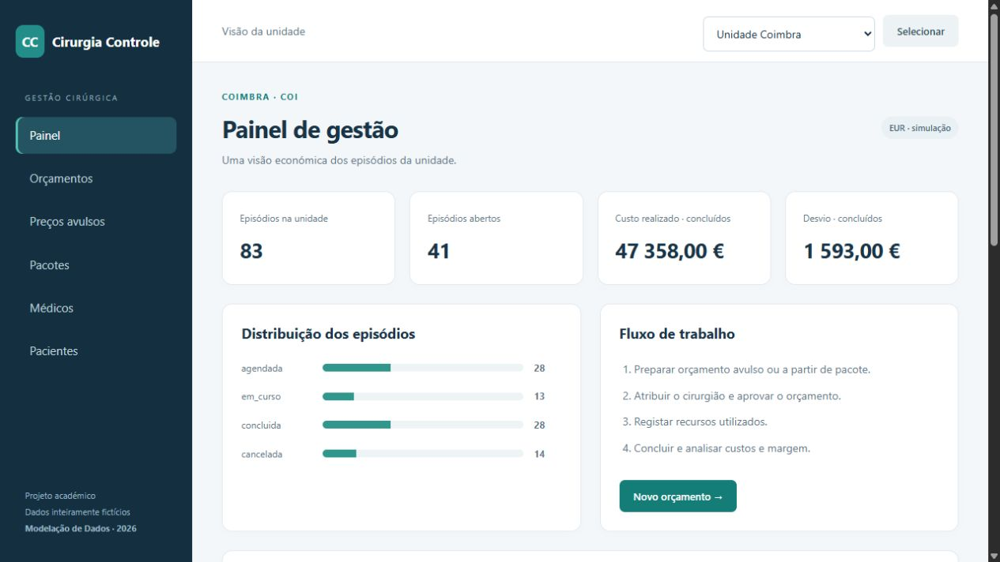

# Cirurgia Controle

Protótipo local de orçamento e controlo de custos cirúrgicos em várias unidades, desenvolvido como projeto académico de modelação de dados.

## Competências demonstradas

- Modelação relacional e desenho de esquema SQLite.
- SQL: consultas, vistas, índices, gatilhos e regras de integridade.
- Aplicação web local em Python, sem dependências externas.
- Testes automatizados, documentação técnica e análise de limitações.

O projeto contém uma base demonstrativa de dados fictícios e documenta 69 testes automatizados aprovados na versão entregue.

## Ficheiros

- [Descarregar o projeto completo](Cirurgia_Controle_Portefolio.zip) — código, base SQLite, scripts SQL, documentação e testes.
- [Ler o relatório](Relatorio_Cirurgia_Controle_Portefolio.pdf) — versão com capa preparada para portefólio.

## Executar

Extraia o ZIP, abra a pasta `project` e execute `iniciar.bat` no Windows. Também pode iniciar com `py -3.13 application/app.py` e abrir `http://127.0.0.1:8000`.

## Limites e transparência

Protótipo académico local: sem dados clínicos reais, autenticação ou integração clínica. Preços e composições são fictícios; o sistema não se destina a uso clínico ou comercial. O projeto documenta o apoio de IA em requisitos, modelação, SQL, implementação, testes e documentação. É um trabalho de grupo; confirme a sua contribuição individual antes de o apresentar como experiência pessoal no CV.
