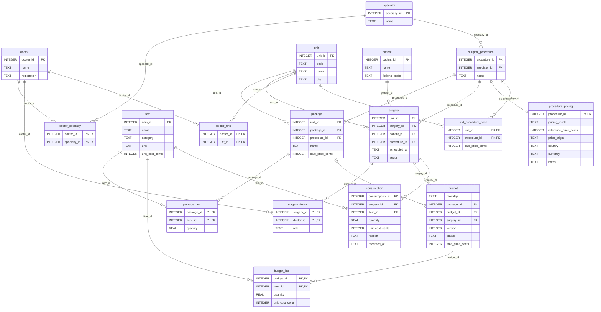

# ERD da versão 1.0

Cardinalidades referem-se à estrutura. Aprovação exige linhas, e conclusão exige cirurgião e consumo, por triggers. Um episódio pode ter zero orçamentos no DDL; o serviço cria sempre um orçamento atomicamente. package_id em budget é opcional apenas na modalidade avulso. Quantidades e snapshots pertencem à associação/operação, não ao catálogo.
